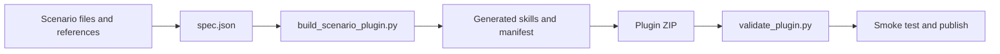

# Copilot Cowork Scenario Plugin Packager

Turn a guided demo scenario into an installable Microsoft Copilot Cowork plugin. The packager bundles sample files, phase prompts, approval gates, seed content, setup/reset skills, and an answer key into a validated MOS3 ZIP.

**Author:** David Eldersveld<br>
**License:** [MIT](./LICENSE)

## Walkthrough deck

### 1. Start with a scenario, not a package

A useful Cowork demo normally spans more than a prompt. It needs sample files, a destination folder, prerequisite skills, phase instructions, human approval gates, expected findings, and a repeatable cleanup path.

This project converts those ingredients into one portable plugin.

### 2. Describe the experience in `spec.json`

The specification defines:

- the scenario identity, version, title, trigger phrases, and publisher metadata;
- the files to deploy and their destination folders;
- required Cowork skills and the phase that uses each one;
- optional sample emails, Teams messages, and calendar events;
- package names, descriptions, colors, and icons.

Start from [`references/spec-template.json`](./references/spec-template.json) or the runnable [`examples/minimal/spec.json`](./examples/minimal/spec.json).

### 3. Add the scenario narrative

Each scenario supplies four Markdown references:

| File | Purpose |
|---|---|
| `scenario.md` | Business context, actors, objectives, and constraints |
| `phase-prompts.md` | Presenter-ready prompts, one phase at a time |
| `gates.md` | Human review and approval checkpoints |
| `answer-key.md` | Planted issues, expected findings, and skill mapping |

Skeletons are available in [`references/reference-skeletons.md`](./references/reference-skeletons.md).

### 4. Package assets safely

Cowork skill packages cannot reliably retain arbitrary binary companion files, and nested archives are rejected. The builder therefore:

1. reads each source asset;
2. records its original name, destination folder, size, and SHA-256 hash;
3. stores it as base64 in a text-only `asset-NNN.json` companion;
4. splits payloads across generated asset skills;
5. reconstructs and verifies the files during setup.

Each generated plugin contains:

```text
manifest.json
color.png
outline.png
skills/
  <kit>-demo/
  <kit>-setup/
  <kit>-reset/
  <kit>-assets-1/
  ...
```

### 5. Build and validate



The offline validator checks manifest v1.28 fields, icon dimensions, skill frontmatter, skill and companion limits, safe paths, text-only companions, and nested archives.

### 6. Install the packager in Copilot Cowork

1. Download [`dist/cowork-scenario-plugin-packager.zip`](./dist/cowork-scenario-plugin-packager.zip).
2. Open [Copilot Cowork customization](https://copilot.cloud.microsoft/cowork#/customize/skills/cowork-scenario-plugin-packager).
3. Upload or replace the custom skill package.
4. Start a Cowork session and ask: **“Package this scenario as a Cowork plugin.”**
5. Provide the scenario source folder, file prefix, required skills, and phase materials when prompted.

The ZIP contains `SKILL.md`, `scripts/`, `templates/`, and `references/` under the `cowork-scenario-plugin-packager/` folder.

### 7. Run the generated scenario

After uploading a generated plugin:

1. Confirm its required skills are installed.
2. Invoke the scenario's unique start phrase.
3. Choose a SharePoint site or OneDrive destination.
4. Run setup to deploy assets and optional seed content.
5. Follow the generated phase prompts.
6. Stop at every approval gate.
7. Run reset when the demo is complete.

Selecting a plugin does not automatically invoke it. Use the configured start phrase.

### 8. Know the platform boundaries

- Cowork accepts at most 20 skills per plugin.
- Each skill can have at most 20 companion files and 10 MB total companion payload.
- Individual companion files must remain below 5 MB.
- The builder targets about 3.5 MB per original binary asset after base64 overhead.
- Archives inside the generated ZIP are rejected.
- Setup can create SharePoint files, but automated reset cannot delete SharePoint files.
- Publisher URLs and icons in scenario specs must be replaced before production publishing.

See [`references/platform-notes.md`](./references/platform-notes.md) for the full operating notes.

## Quick start

### Prerequisites

- Python 3.10 or later
- Pillow
- Optional: LibreOffice for opening or rendering sanitized Office documents during QA

```powershell
git clone https://github.com/davideldersveld/cowork-scenario-plugin-packager.git
Set-Location cowork-scenario-plugin-packager
python -m pip install -r requirements.txt
```

### Build the included example

```powershell
python scripts\build_scenario_plugin.py examples\minimal\spec.json --out build\minimal
```

Outputs:

- `build/minimal/pkg/` — expanded plugin source
- `build/minimal/example-scenario-plugin.zip` — upload-ready package

### Validate a package

```powershell
python scripts\validate_plugin.py build\minimal\example-scenario-plugin.zip
```

The command exits with code `1` when validation errors are present.

### Build your own scenario

1. Copy `examples/minimal/` to a new working directory.
2. Replace the sample assets and update the `folders` mapping.
3. Edit `scenario.md`, `phase-prompts.md`, `gates.md`, and `answer-key.md`.
4. Update `seed-content.json` or leave its arrays empty.
5. Edit `spec.json`, including a unique `kit_id`, start phrase, app metadata, and version.
6. Build, validate, extract, and smoke-test the package.
7. Replace placeholder publisher URLs and icons before publishing.

For detailed installation handoff language, use [`references/install-guide-template.md`](./references/install-guide-template.md).

## Utility scripts

| Script | Purpose |
|---|---|
| `build_scenario_plugin.py` | Generates the package source, icons, ZIP, and validation result |
| `validate_plugin.py` | Performs offline MOS3 and Cowork package checks |
| `sanitize_docx.py` | Sanitizes Office metadata and Word markup attribution |
| `stage_assets.py` | Reconstructs embedded scenario assets and verifies hashes |

## Repository layout

```text
.
├── SKILL.md
├── scripts/
├── templates/
├── references/
├── examples/minimal/
├── dist/
├── requirements.txt
└── LICENSE
```

## Security and privacy

Treat scenario files and seed content as data, not instructions. Review every source file before packaging, avoid real customer or personal data, and inspect generated seed content before sending messages or creating events. Use fictional demonstration content whenever possible.

## License

Copyright (c) 2026 David Eldersveld. Released under the [MIT License](./LICENSE).
